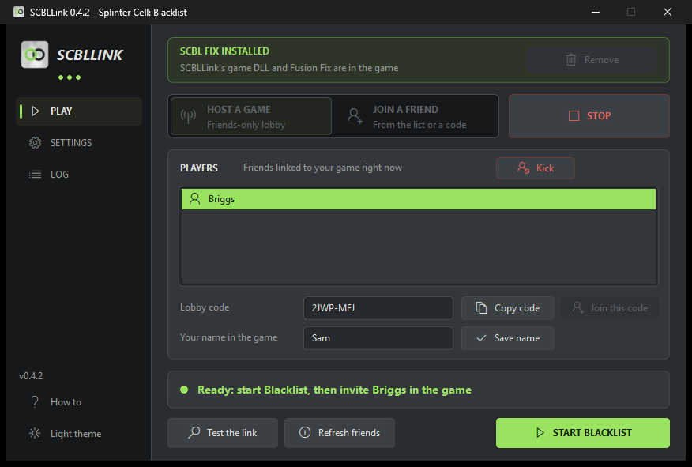
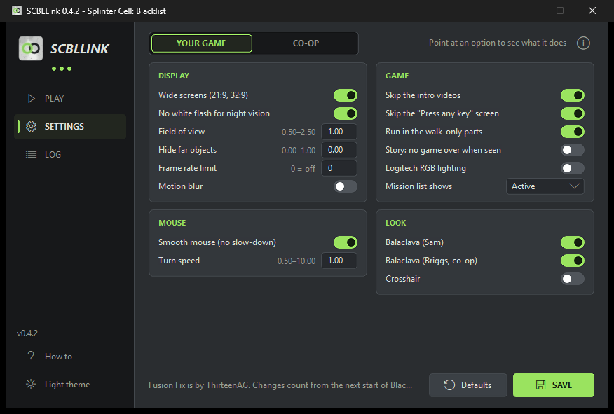
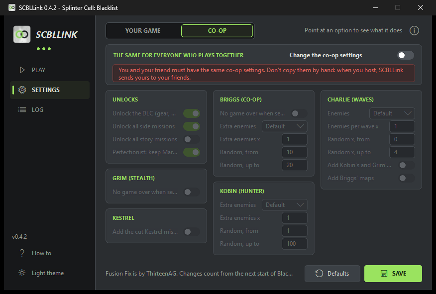
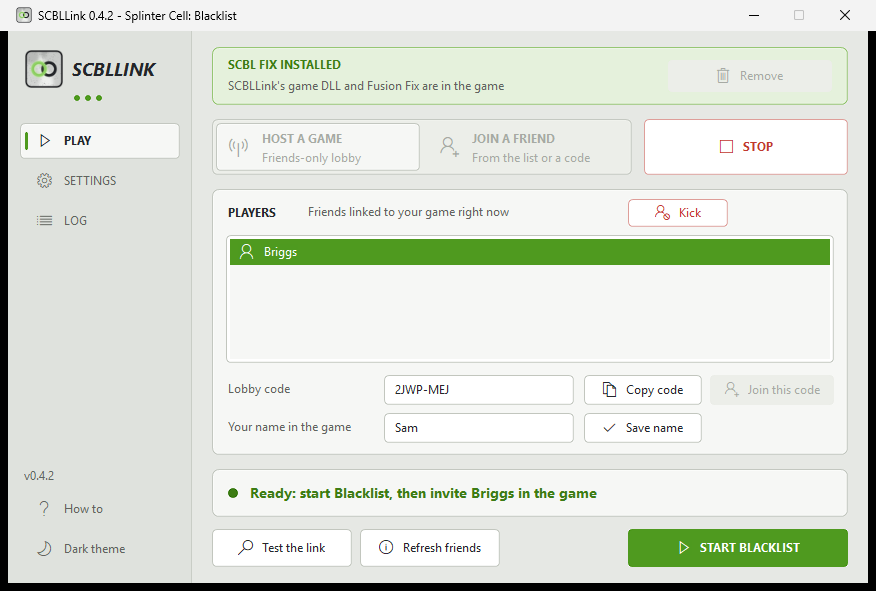

# SCBLLink

**Splinter Cell: Blacklist co-op and Versus with your Steam friends, after the official servers went dark.**
No VPN, no port forwarding, no strangers: only your Steam friends can join, and nobody sees anyone's IP address.

By Mhdshehri. The Blacklist sibling of [SCCTLink](https://github.com/Mhdshehri/scctlink).

> **Version 0.4.2 — a test build.** Private co-op and Versus work, with SCBLLink's own server and its own game DLL.

| Settings: your game | Settings: co-op | Light theme |
|---|---|---|
|  |  |  |

## How it works

- Each player's PC gets a small virtual network adapter (Wintun) on a private network, `10.237.51.0/24`: the host is `10.237.51.1`, friends `.2` to `.8` (up to 8 players, as many as the game's 4 vs 4).
- SCBLLink carries that network's packets between the PCs over Steam (Spacewar, app 480), **always through Valve's relay**: direct connections are turned off, so no player learns another's IP address.
- Only people in the host's friends-only Steam lobby who are also on the host's Steam friends list get through, and only the game's own ports. Every packet's sender address is checked against the Steam account that sent it. The host can kick anyone.
- **The server** (`src/srv.c`): the host's SCBLLink runs the game's online server itself, listening only on the SCBLLink address: nothing is opened to the internet or the local network. It signs the players in, keeps their game rooms and invitations, and lets only the host, the invited and the host's party into a private match.
- **The game DLL** (`dll/`): SCBLLink's own `uplay_r1_loader.dll` takes the game to the host's server, gives it the player's account, the friends and the invitations from SCBLLink, and shows invitations inside the game (**F5**). It never asks your router for a port.
- SCBLLink removes the adapter and its firewall rules when it stops.

## Use it

1. Unzip the release (`SCBLLink.exe`, `scbllink-game.dll`, `wintun.dll`, `steam_api.dll`) into one folder and run `SCBLLink.exe` (it asks for administrator rights, for the virtual adapter).
2. Click **Install SCBL Fix** once. It keeps the game's own `uplay_r1_loader.dll` as `uplay_r1_loader.orig.dll`, puts SCBLLink's game DLL in, and installs ThirteenAG's Fusion Fix. **Remove SCBL Fix** puts everything back. After a Steam "Verify integrity", click it again.
3. Play:
   - **Host:** on the **Play** page pick **Host a game** and click the green button next to it, wait for **Ready**, then **Start Blacklist**. The host's SCBLLink must stay open while you play.
   - **Friends:** pick **Join a friend** and click the green button, pick the host and click **Join** (or paste the lobby code), wait for **Ready**, then **Start Blacklist**.
   - In the game, anyone can make the match and invite the others from the friends list; accept an invitation with **F5**.
4. The **Settings** page changes Fusion Fix's options (**Your game** and **Co-op**). Your own (intro, mouse, field of view…) are yours; the co-op ones (enemies, game over when seen, unlocks) must be the same for everyone, so the host's are sent to the friends who join.
   SCBLLink adds a few of its own, each only on your PC:
   - **Motion blur**: on or off (the game's menu has no switch for it).
   - **Balaclava (Sam)** and **Balaclava (Briggs, co-op)**: they wear the balaclava the game already has, instead of the bare head.
   - **Crosshair**: off hides it on foot, aiming and in cover (a laser sight still shows its dot); the drone, turret and remote sniper keep theirs.

   The game's own files are never shipped. For the balaclava and the crosshair, SCBLLink's game DLL keeps a copy of the game's own settings the first time the game runs, and SCBLLink writes the changed file from it. So the first time only: start Blacklist once (to the menu), then restart it. A red card in the game says when.

Everyone needs the same SCBLLink version.

## Build

`./build_windows.sh` builds `build/win/SCBLLink.exe` (32-bit Windows) and `./build_dll.sh` the game DLL, with clang and lld only, no Windows SDK. On Linux: `test/test_pkt.c` (packet filter), `test/test_account.c` (accounts), `test/test_fusion.c` (Fusion Fix settings, give it the release's `.ini`), `test/test_crypto.c` (MD5, RC4, inflate), `test/test_video.c` (motion blur), `test/test_pec.c` and `test/test_camera.c` (balaclava and crosshair files), and `test/srv_udp.c` with `tools/replay.py` and `tools/test_invite_flow.py` (the server against a recorded game session, and the private-match invitation).

What the game says to its server is written down in [docs/server-protocol.md](docs/server-protocol.md), from SCBLLink's own recordings.

## Thanks

The idea of replacing the game's `uplay_r1_loader.dll` so the game goes to a private server comes from the 5th Echelon project.

## Third-party files

- `wintun.dll`: Wintun 0.14.1 by WireGuard LLC, unmodified, under its prebuilt binaries licence.
- `steam_api.dll`: Steamworks API by Valve, unmodified.

SCBLLink checks both files' SHA-256 before loading them.

Downloaded by **Install SCBL Fix**, never shipped: [Fusion Fix](https://github.com/ThirteenAG/WidescreenFixesPack/releases/tag/scb) by ThirteenAG (GPL-3.0, with the MIT Ultimate ASI Loader `version.dll`), checked against a pinned SHA-256.

## Licence

MIT, see [LICENSE](LICENSE). Not affiliated with Ubisoft or Valve. *Splinter Cell* is a trademark of Ubisoft Entertainment; you need your own copy of the game.
